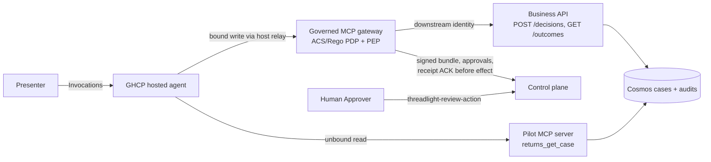

# Governed-write workshop kit (GHCP)

Show **one governed write live** in a workshop on the default runtime: a GitHub
Copilot SDK hosted agent (Foundry, Invocations) that reads freely and can record
exactly one consequential decision, `returns_apply_decision`, only through the
authenticated governed MCP gateway. Four business rules in Rego decide
**allow**, **deny** or **escalate** (a human Approver decides before the write).

The pilot is designed in the `governed-write` action mode
([`specs/`](specs/SPEC.md), checked by `skills/_shared/action_mode.py`): between
the recommend-only Fast-PoC and the Production path. Participants' pilots stay
recommend-only; the facilitator shows this one.

**Live status:** executed on 2026-11-10 in a nonproduction Azure subscription;
see [S8 in the execution record](../../docs/governed-returns-validation.md#s8-governed-write-on-ghcp-workshop-kit).
That evidence covers **this one binding** in that deployment, not whole-agent
governance, network isolation, OBO or production readiness. A new deployment
needs its own fresh evidence. The write records a synthetic return decision and
audit in Cosmos; it is **never a payment or settlement**.



## The four rules ([`governed_write.rego`](governance/policy/governed_write.rego))

| # | Rule | Verdict |
|---|---|---|
| 1 | Case not in the signed case snapshot | deny `case_not_in_signed_snapshot` |
| 2 | `approve_refund` on an ineligible case, or `deny_refund` on an eligible one | deny `refund_eligibility_mismatch` |
| 3 | Amount above 500 or high risk: `escalate_to_supervisor` | **escalate**: deferred human approval, then the write |
| 3b | Same case, any other decision | deny `high_value_requires_supervisor` |
| 4 | Ordinary decision on an ordinary case | allow, recorded autonomously |

The business API independently re-checks revision (`_etag` CAS), status and the
same invariants in one transactional batch. Case facts come from the signed
snapshot generated from [`governance/cases.json`](governance/cases.json) (five
sets of A ordinary, B ineligible, C high value). A decided case is never reset:
use the next set for the next workshop.

## Before the workshop (facilitator, once per tenant)

Prerequisites: an internal nonproduction subscription, `az` and `azd` (1.34+)
logged in to the intended tenant, rights to register Entra apps, and the
catalog's native test environment (Linux amd64, exact pins) for policy builds.
Images are built only with `azd` remote builds (`docker.remoteBuild: true`).
Keep every operator file (IDs, URLs, envelopes) **outside this repository**.

1. **Pilot infrastructure.** Start from the GHCP pilot template
   (`skills/threadlight-deploy/references/hosted-agent/ghcp/references/pilot`),
   copy this example's `src/mcp/` and `src/agent/copilot-instructions.md`, set the
   MCP app's `AZURE_CLIENT_ID`, `RETURNS_COSMOS_URL`, `RETURNS_COSMOS_DATABASE=returns`
   and `RETURNS_COSMOS_CONTAINER=returns-cases` in its Bicep, and `azd provision`.
2. **Entra APIs.** `python scripts/entra_apps.py --prefix <name> --review-client <public-client-id> --approver <your-object-id>`
   creates the control-plane, gateway and business APIs (v2 tokens, `idtyp`
   optional claim, `Governance.Workload` app role, delegated
   `Governance.Approve`/`Governance.Read`). Without the `idtyp` claim workload
   tokens are rejected.
3. **Governance foundation.** Write `infrastructure.json`
   ([contract](../../skills/threadlight-deploy/references/governance/README.md#infrastructure-and-entra-contract);
   `environment: preproduction`, `runtime: github-copilot-sdk`,
   `enable_gateway: true`, `approval_max_seconds: 900`, `min_replicas: 0` (control
   plane and gateway scale to zero between workshops), `network.posture:
   public-authenticated-proof` with `preserve_resources: true`, and optional
   `tags` for owner/purpose/disposition), then
   `generate.py foundation` and `azd provision`. If organization policy disables
   public access on new data resources, use your approved exception mechanism
   through `tags`; never weaken authentication.
4. **Business authority.** Deploy [`infra/business.bicep`](infra/business.bicep)
   without `businessImage`, publish the publisher image (a context with the
   portable control plane and [`scripts/publish_policy.py`](scripts/publish_policy.py))
   and the business image (`package_returns_mcp.py` output) with `azd publish`,
   then seed: `python scripts/seed_cases.py --cosmos-url <url> --outside-snapshot RMA-NEW-0001`.
5. **Bootstrap package.** `python scripts/build_policy.py --bootstrap --version 1 --destination <dir>`,
   then run the publisher job with `TL_MODE=sign-only` for that digest. The
   gateway path does not embed the bundle in the agent image, so the bootstrap
   envelope is signed but **not published**: `returns-write/1` stays reserved for
   the final registry bundle (Blob publication is `overwrite=False`).
6. **Agent.** `generate.py generate` with `package.json` (`mcp_servers` with the
   pilot MCP URL and explicit `tools: [returns_get_case, returns_apply_decision]`,
   `mcp_bindings` for the write), build the agent image with `azd publish`, then
   `generate.py agent-image` and `azd deploy <agent>`. Read the agent's instance
   identity and version (`azd ai agent show`).
7. **Final signed policy.** `build_policy.py --operator-config <observed values>`
   (agent principal, version, image digest, gateway and business URLs), then the
   publisher job with `TL_MODE=publish`. The registry selects
   `approval_mode: deferred`, `approval_requirement: policy`, role `Approver`.
8. **Gateway.** `generate.py stage-gateway`, then `azd publish` the gateway image.
9. **Grants.** `Governance.Workload` on the control-plane API for the agent and
   gateway identities, on the gateway API for the agent, on the business API for
   the gateway's downstream identity.
10. **Bind and run.** `generate.py bind` with the observed images, identities,
    applications, assignments and foundation outputs; `azd provision` (services
    phase); deploy the business API with its configuration (final policy digest
    and registry `deployment`). Restart the control-plane revision after Entra
    changes. Check gateway `/health`: `returns_apply_decision` healthy.

## During the workshop (about 10 minutes)

```sh
python scripts/demo_capacity.py warm --resource-group <rg> --apps <control> <gateway> <business> <mcp> \
  --gateway-url https://<gateway>/mcp --business-url https://<business> \
  --project-endpoint https://<account>.services.ai.azure.com/api/projects/<project>
E=--project-endpoint\ https://<account>.services.ai.azure.com/api/projects/<project>
python scripts/invoke.py $E --evidence allow.jsonl  --prompt "Triage return case RMA-W04-A and record your decision."
python scripts/invoke.py $E --evidence deny.jsonl   --prompt "Triage return case RMA-NEW-0001 and record your decision."
python scripts/invoke.py $E --evidence review.jsonl --pending pending.json --prompt "Triage return case RMA-W04-C and record your decision."
threadlight-review-action --pending pending.json --control-plane-url https://<control> \
  --scope api://<control-api-id>/Governance.Approve --tenant <tenant> --client-id <public-client-id> \
  --role Approver --decision approve
python scripts/invoke.py $E --evidence resume.jsonl --resume pending.json
python scripts/invoke.py $E --evidence replay.jsonl --resume pending.json   # same audit_id, no new effect
python scripts/demo_capacity.py cool --resource-group <rg> --apps <control> <gateway> <business> <mcp>
```

`threadlight-review-action` shows the exact proposal, asks for a typed
confirmation and then opens the system browser for the Approver's own sign-in;
set `BROWSER="open -a 'Microsoft Edge' %s"` (macOS) to choose the browser. Run it
in a terminal the Approver can see.

What to point at: the allow returns an `audit_id`; the deny records nothing
(`policy_deny`); the escalation returns `pending_approval` with **no effect** and
the host (not the model) emits `event: governance_pending`; the Approver signs in
as themselves; the resumed call re-checks policy, facts, identity and expiry and
consumes the grant once; the replay returns the same outcome. A central receipt
ACK precedes every business write.

The model follows its instructions and usually refuses a prohibited decision
itself (in the live run it chose `deny_refund` instead of approving an
ineligible case). That is model behavior, not governance; the gateway deny is
shown with the case created **after** the signed snapshot (`RMA-NEW-0001`).

## Known limits and operator notes

- **Cold start = unknown outcome.** Scale-to-zero services are not warm enough
  for the gateway's bounded downstream call: in the first live call the business
  API committed the write ~26 s after the allow receipt and the agent correctly
  reported an unknown outcome. Run `demo_capacity.py warm` first. An unknown
  operation stays pending: reconcile from independent records, never retry.
- With `min_replicas: 0` nothing stays always on between workshops; the price
  is a cold start, which is why the warm step exists. Production keeps the
  default of 1.
- Policy expiry bounds the kit (the live run used about three weeks). Renewal is
  a new signed version, which requires regenerating the agent package (its
  configuration pins the policy version).
- Each GHCP invocation is a new Copilot session: resume is a new invocation with
  the exact original arguments, not same-session resume.
- Advanced variants stay opt-in and outside this demo path: native Outlook
  approval, requesting-user confirmation (MAF only), signed JWT evidence,
  operator recovery/fences, mixed native/gateway bindings, Citadel routing.
